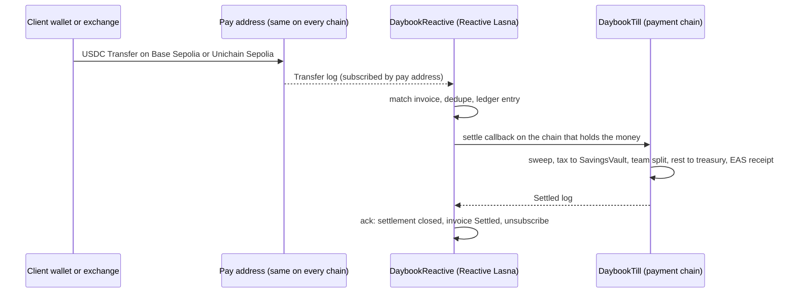

<!-- Generated by tools/judge/generate.mjs from evidence/summary.json. Edit the generator, then run `make docs`. -->

# Daybook

Daybook is an invoice that marks itself paid: the client sends USDC to one address on Base Sepolia or Unichain Sepolia, and a reactive contract on Reactive Network matches the payment, sweeps it, sets tax aside, pays the team split and issues a receipt, with no server of mine involved.

In 7 traced settlements across 6 invoices, every payment that should have closed did close on the first send, with no resend. Measured on Base Sepolia's millisecond block clock, the settlement callback landed a median 1.2 s after the payment (n = 5, range 1.0 s to 1.8 s).

Daybook runs on testnets only: Reactive Lasna, Base Sepolia and Unichain Sepolia, with Circle's test USDC. I have no mainnet funds for it right now, so there is no mainnet deployment and no real money has gone through it.

## Live site, video and addresses

- Live site: https://daybook-omni.vercel.app. You can try it without a wallet: press **Pay a demo invoice** on the home page. A demo wallet sends 0.10 test USDC on Base Sepolia to a real demo invoice, and you watch its pay page go from waiting to Paid as the reaction, the settlement callback and the acknowledgement land.
- Video: coming
- Health, read from chain as of 19 Nov 2026, 15:11:38 UTC (Lasna block 8,742,565): running since 19 Nov 2026, 6 of 11 invoices settled, 0.5144 lREACT spent on 16 measured reactions. The live numbers are at https://daybook-omni.vercel.app/health.

Current deployment (v1). Every contract is verified on Sourcify; the superseded v0 and the unused v1-a are in [docs/DEPLOYMENTS.md](docs/DEPLOYMENTS.md).

| Contract | Chain | Address | Sourcify |
|---|---|---|---|
| DaybookReactive | Reactive Lasna | [`0x182BA62E240433B54136712d8840Ccc354bb78d3`](https://lasna.reactscan.net/address/0x182BA62E240433B54136712d8840Ccc354bb78d3) | [exact_match](https://repo.sourcify.dev/5318007/0x182BA62E240433B54136712d8840Ccc354bb78d3) |
| PayAddressFactory | Base Sepolia | [`0xA7984241CC7596B0ED7C3b71409Bda7cf6E0D33c`](https://sepolia.basescan.org/address/0xA7984241CC7596B0ED7C3b71409Bda7cf6E0D33c) | [exact_match](https://repo.sourcify.dev/84532/0xA7984241CC7596B0ED7C3b71409Bda7cf6E0D33c) |
| PayAddressFactory | Unichain Sepolia | [`0xA7984241CC7596B0ED7C3b71409Bda7cf6E0D33c`](https://unichain-sepolia.blockscout.com/address/0xA7984241CC7596B0ED7C3b71409Bda7cf6E0D33c) | [exact_match](https://repo.sourcify.dev/1301/0xA7984241CC7596B0ED7C3b71409Bda7cf6E0D33c) |
| InvoiceVault implementation | Base Sepolia | [`0xCDE82FE77A96C255154341A6839cDEfe71f6e348`](https://sepolia.basescan.org/address/0xCDE82FE77A96C255154341A6839cDEfe71f6e348) | [exact_match](https://repo.sourcify.dev/84532/0xCDE82FE77A96C255154341A6839cDEfe71f6e348) |
| InvoiceVault implementation | Unichain Sepolia | [`0xCDE82FE77A96C255154341A6839cDEfe71f6e348`](https://unichain-sepolia.blockscout.com/address/0xCDE82FE77A96C255154341A6839cDEfe71f6e348) | [exact_match](https://repo.sourcify.dev/1301/0xCDE82FE77A96C255154341A6839cDEfe71f6e348) |
| DaybookTill | Base Sepolia | [`0x4Bd6fE154dF715608eE3294BB3EcA4028703bba9`](https://sepolia.basescan.org/address/0x4Bd6fE154dF715608eE3294BB3EcA4028703bba9) | [exact_match](https://repo.sourcify.dev/84532/0x4Bd6fE154dF715608eE3294BB3EcA4028703bba9) |
| SavingsVault | Base Sepolia | [`0xb444ca6477cc594E35a5676d5f7ABa51E7c5CC26`](https://sepolia.basescan.org/address/0xb444ca6477cc594E35a5676d5f7ABa51E7c5CC26) | [exact_match](https://repo.sourcify.dev/84532/0xb444ca6477cc594E35a5676d5f7ABa51E7c5CC26) |
| EasReceiptIssuer | Base Sepolia | [`0xf36c602e30828881A9Aa46782fAB974584807e36`](https://sepolia.basescan.org/address/0xf36c602e30828881A9Aa46782fAB974584807e36) | [exact_match](https://repo.sourcify.dev/84532/0xf36c602e30828881A9Aa46782fAB974584807e36) |
| DaybookTill | Unichain Sepolia | [`0xAea11aFA4f56f8f7952cE543Ea49421D70d5EFCf`](https://unichain-sepolia.blockscout.com/address/0xAea11aFA4f56f8f7952cE543Ea49421D70d5EFCf) | [exact_match](https://repo.sourcify.dev/1301/0xAea11aFA4f56f8f7952cE543Ea49421D70d5EFCf) |
| SavingsVault | Unichain Sepolia | [`0xc03A2Ce7cc50B940f063eA39FBbFE51bf1750668`](https://unichain-sepolia.blockscout.com/address/0xc03A2Ce7cc50B940f063eA39FBbFE51bf1750668) | [exact_match](https://repo.sourcify.dev/1301/0xc03A2Ce7cc50B940f063eA39FBbFE51bf1750668) |
| EasReceiptIssuer | Unichain Sepolia | [`0x0c1eA9879bFEa9Ce280D2bdb1b7755989d2D64aE`](https://unichain-sepolia.blockscout.com/address/0x0c1eA9879bFEa9Ce280D2bdb1b7755989d2D64aE) | [exact_match](https://repo.sourcify.dev/1301/0x0c1eA9879bFEa9Ce280D2bdb1b7755989d2D64aE) |

## The problem

Getting paid in stablecoins sounds simple until you do it every month. Someone has to watch several explorers, work out which transfer belongs to which invoice, mark it paid somewhere, send a receipt, move the tax share aside and pay the people who did the work. Every one of those steps is manual, and every one is a chance to get it wrong. Anyone who invoices in USDC has this problem, and it grows with each chain a client might pay from.

I built Daybook for my own company's invoices.

## How it works



1. I create an invoice directly on the reactive contract: amount, accepted chains and tokens, due date and a split policy. Its pay address comes from CREATE2 through a factory at the same address on every payment chain, so it is the same everywhere and needs no deployment until it is swept.
2. On creation the contract subscribes, per accepted chain and token, to `Transfer` logs whose recipient is the pay address. On settlement it unsubscribes with exactly the same arguments.
3. When a matching transfer lands, the reaction checks the token and amount, records partial payments and overpayments in an on-chain ledger, and once the invoice is covered asks the till on that chain to settle.
4. The till sweeps the pay address, sends the tax share to the savings vault, pays the team, sends the rest to the treasury and issues an EAS attestation to the payer. Its `Settled` log comes back to the reactive contract as the acknowledgement; a missing ack is resent on a cron tick.

[docs/ARCHITECTURE.md](docs/ARCHITECTURE.md) has the details, including how pay addresses are derived and what each contract may do.

## Why it needs Reactive

The client pays with a plain USDC transfer from any wallet or exchange. A transfer to an address runs no code of mine on the payment chain, so nothing on that chain can notice it, let alone settle it. Something has to watch logs on several chains and then act on the chain where the money is.

Without Reactive that something is a server: a process polling each chain's RPC and holding a key that can sweep pay addresses. If it is down, invoices sit unpaid. If it is compromised, the key can move the money. A cron job is the same server on a timer: it still needs my machine, my RPC keys and a hot key, and it only notices payments when it next wakes up.

With Reactive the subscriptions are state of the reactive contract, the network runs the reaction when the log appears, and the callback reaches the till through the chain's callback proxy. The till accepts `settle` only from that proxy and only on behalf of my reactive contract, so no key of mine sits anywhere online. If the website and its database disappear, payments still reconcile and settle; the web app's database-down test covers the site side of that.

## One real loop, hop by hop

Invoice 1 on v1, 1.00 USDC, paid exactly on Base Sepolia (v1-L1-exact in [evidence/loops.csv](evidence/loops.csv)).

| Hop | Transaction | Block time | What happened |
|---|---|---|---|
| 1. Payment | Base Sepolia [`0x83f977cb…ad6b`](https://sepolia.basescan.org/tx/0x83f977cbdfafa67375d522af4875de0e09c0a67a75a79923f967e168122aad6b) | 08:56:10.600 | The client's USDC transfer to the pay address |
| 2. Reaction | Lasna [`0xc4088634…049e`](https://lasna.reactscan.net/tx/0xc4088634fc23911523f4416d44aeeb0bfd01f42300825201a7b541cb87fd049e) | 08:56:10 UTC | Matched invoice 1, wrote the ledger entry, requested settlement 1; cost 0.0528 lREACT |
| 3. Callback | Base Sepolia [`0x5569926a…5ede`](https://sepolia.basescan.org/tx/0x5569926add8acec5aaf62de139f33380d89ead0b1fcf9b24c0eb89990af75ede) | 08:56:12.000 | The till swept the pay address, split the money and issued the EAS receipt; 610,598 gas, 0.00000447 ETH |
| 4. Ack | Lasna [`0x3793b502…e2a8`](https://lasna.reactscan.net/tx/0x3793b50209a91d710a38eee163783264aad46e0b7d814c42c8acb3b5617ce2a8) | 08:56:11 UTC | The `Settled` log closed the settlement and the invoice; cost 0.0171 lREACT |

The callback landed 1.4 s after the payment on Base's own millisecond clock. Lasna stamps whole seconds and runs one to two seconds behind Base, which is why its times above look earlier than the payment; cross-chain differences are kept raw in the CSV and never reported as latency (docs/FIRST_LOOPS.md, Latency). The cross-chain case, v1-L5-crosschain, is in [JUDGE.md](JUDGE.md).

## Evidence and how to reproduce it

From [evidence/loops.csv](evidence/loops.csv), 12 rows written by the loop tracer (`scripts/src/trace`), one per traced payment and settlement, failures kept:

| Measure | Value |
|---|---|
| Payments traced | 10 |
| Settlements closed (payment, reaction, callback, ack) | 7 |
| Invoices settled in the traced loops | 6 |
| Settlements left unclosed | 0 |
| Wrong-token transfers flagged on a watch-all invoice | 1 |
| Wrong-token transfers not delivered to an accepted-token invoice, as designed | 1 |
| Payments delivered more than once | 0 |
| EAS receipts issued / failed | 6 / 1 (the failure is the v0 gas limit the security review predicted) |
| Payment to callback, Base Sepolia ms clock | median 1.2 s, range 1.0 s to 1.8 s, n = 5 |
| Reaction to ack on Lasna | 1.0 s to 2.0 s, n = 7 |
| lREACT per single-chain loop on v1 (cover plus ack) | 0.0613 to 0.0699, n = 4, plus about 0.02 lREACT to create the invoice |
| Callback fee on Base Sepolia | 0.00000424 ETH to 0.00000447 ETH, n = 5 |

From chain, at 19 Nov 2026, 15:11:38 UTC (Lasna block 8,742,565), for the whole v1 deployment including the live demo: 9 ledger entries; 10 transfers into v1 pay addresses on both payment chains: 8 matched to an invoice, 1 flagged as a wrong token, 1 in a token the invoice does not accept and does not watch, so it was never delivered, 0 unaccounted for; 7 settlement splits recomputed from their policies and matched to the transfers in their callbacks; no accepted token left at any settled pay address.

| Invoice | Status | Amount | Paid | Ledger entries | Received at the pay address | Swept by callbacks | Accepted token left | Other tokens left (flagged) |
|---|---|---|---|---|---|---|---|---|
| 1 | Settled | 1.00 | 1.00 | 1 | 1.00 | 1.00 | 0.00 | none |
| 2 | Settled | 2.00 | 2.00 | 2 | 2.00 | 2.00 | 0.00 | 1.00 of 0xBF1Bfc97…Dee7 on Base Sepolia |
| 3 | Settled | 1.00 | 1.00 | 1 | 1.50 | 1.50 | 0.00 | none |
| 4 | Settled | 1.00 | 1.00 | 2 | 1.00 | 1.00 | 0.00 | 1.00 of 0xBF1Bfc97…Dee7 on Base Sepolia |
| 5 | Settled | 2.00 | 2.00 | 2 | 2.00 | 2.00 | 0.00 | none |
| 6 | Settled | 0.10 | 0.10 | 1 | 0.10 | 0.10 | 0.00 | none |
| 7 | Open | 0.10 | 0.00 | 0 | 0.00 | 0.00 | 0.00 | none |
| 8 | Open | 0.10 | 0.00 | 0 | 0.00 | 0.00 | 0.00 | none |
| 9 | Open | 0.10 | 0.00 | 0 | 0.00 | 0.00 | 0.00 | none |
| 10 | Open | 0.10 | 0.00 | 0 | 0.00 | 0.00 | 0.00 | none |
| 11 | Open | 0.10 | 0.00 | 0 | 0.00 | 0.00 | 0.00 | none |

To reproduce:

```
make verify            # re-reads every row, ledger entry, split, contract and doc link from public RPCs and Sourcify
make verify FRESH=1    # the same without the receipt cache
make summary           # rebuilds evidence/summary.json (tests plus a new chain snapshot), then README.md and JUDGE.md
```

`make verify` rebuilds every number above from RPC data alone, checks the live Health page against chain, writes [evidence/verify-report.json](evidence/verify-report.json) and exits non-zero on any mismatch. The first run takes a few minutes on public RPCs; reruns use the cache in `tools/verify/.cache`.

## Run it locally

You need Node 24 or later, pnpm 12.8.1 and Foundry 1.8.4.

```
git clone --recurse-submodules https://github.com/Adwaitbytes/daybook
cd daybook
make test                                  # verify's tests, the Foundry suite, then the CLI and tracer tests
cd web && pnpm install --frozen-lockfile --allow-build esbuild && pnpm dev   # http://localhost:3000, reading the live Lasna deployment
```

The web app needs no keys to read: it takes the reactive contract's address from docs/DEPLOYMENTS.md and reads everything else from public RPCs. The demo button and the database are optional and show a designed state when unset (`web/.env.example` lists the variables).

152 of 152 Foundry tests pass (142 unit, 9 fuzz, 1 invariant, in 15 suites), 40 of 41 web tests (1 skipped: the live database test, which needs `DATABASE_URL`), 9 of 9 CLI and tracer tests and 7 of 7 verify tests.

## Limits and trust assumptions

- **Testnet only.** Everything runs on Reactive Lasna, Base Sepolia and Unichain Sepolia with test USDC. I have no mainnet funds for Daybook right now, so there is no mainnet deployment, no real money in it and no mainnet history to show.
- **Amounts are public.** Invoice amounts, pay addresses, payers and the split are on chain for anyone to read. Only client names and notes stay off chain, and the chain holds just their hash.
- **Trust in Reactive.** Settlement depends on Reactive Network delivering the payment log and relaying the callback. If it stops, money waits safely at the pay address and the owner can sweep it by hand (`DaybookTill.sweep`), but nothing settles on its own.
- **Unaudited, so capped.** The contracts had an internal adversarial review (docs/SECURITY_REVIEW.md) and no external audit. Read from chain at the snapshot, the till caps are 20.00 USDC per settlement on Unichain Sepolia and 20.00 USDC per settlement on Base Sepolia, and the reactive contract refuses any invoice above 20.00 USDC.
- **The REACT balance runs out.** Every reaction is paid from the reactive contract's lREACT. When it hits zero the contract goes into debt and the network stops calling it until someone tops it up; the Health page shows the balance and how many reactions it still pays for.

The full list, including spam with real tokens, owner trust and token quirks, is in [docs/LIMITS.md](docs/LIMITS.md).

## Dependencies and what was built during the event

Everything in this repository was written during the event: the first commit is from 19 Nov 2026 and every commit since is later. Shared tooling (the writing check, the Slither gate, the smoke test and parts of verify) is copied between my three entries so each repository stands alone.

| Dependency | Version | Used for |
|---|---|---|
| Foundry (forge, cast) | 1.8.4 | build, test, deploy |
| Node.js | 24 or later | web app, CLI, tracer, verify |
| pnpm | 12.8.1 | package manager |
| forge-std | v1.17.0 | Solidity library (git submodule) |
| openzeppelin-contracts | v5.7.0 | Solidity library (git submodule) |
| reactive-lib-omni | v0.1.0 | Solidity library (git submodule) |
| @biomejs/biome | 2.6.8 | web app |
| @neondatabase/serverless | 1.2.1 | web app |
| @playwright/test | 1.65.1 | smoke test of the live site |
| @tailwindcss/postcss | 4.3.5 | web app |
| @tanstack/react-query | 5.108.0 | web app |
| @types/node | 24.10.1 | web app, CLI and loop tracer, make verify and make summary |
| @types/qrcode | 1.5.6 | web app |
| @types/react | 19.3.0 | web app |
| @types/react-dom | 19.3.0 | web app |
| drizzle-kit | 0.31.11 | web app |
| drizzle-orm | 0.45.4 | web app |
| motion | 14.14.0 | web app |
| next | 16.4.6 | web app |
| playwright | 1.65.1 | web app |
| qrcode | 1.5.4 | web app |
| react | 19.3.1 | web app |
| react-dom | 19.3.1 | web app |
| server-only | 0.0.1 | web app |
| tailwindcss | 4.3.5 | web app |
| typescript | 5.9.3 | web app, CLI and loop tracer, make verify and make summary |
| viem | 2.58.1 | web app, CLI and loop tracer, make verify and make summary |
| vitest | 5.1.1 | web app |
| wagmi | 3.7.11 | web app |
| Slither | 0.11.6 | static analysis in CI |
| gitleaks | 8.30.1 | secret scan of the full history in CI |

MIT licensed.
